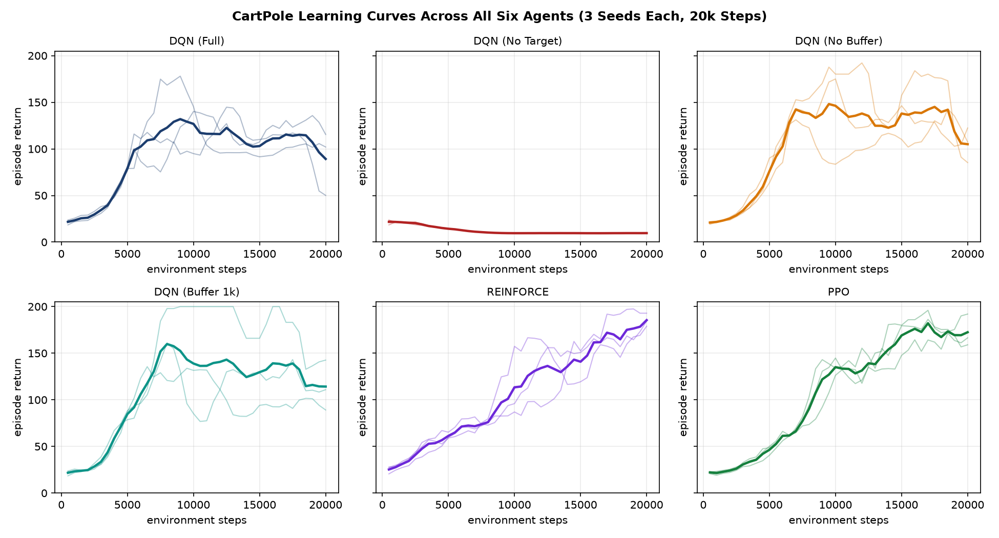
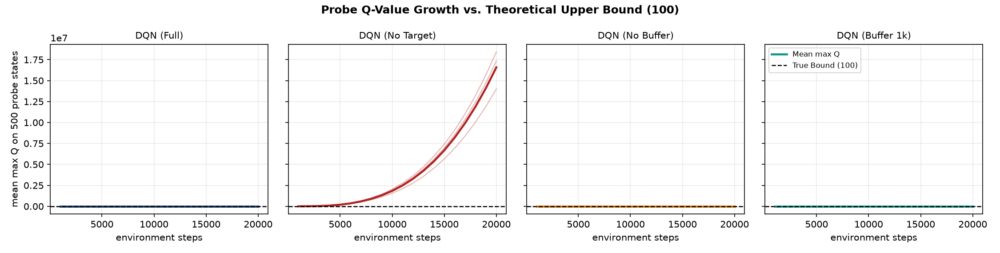

# Training an RL Agent
DQN, two ablations, REINFORCE and PPO written from scratch on CartPole,
with the same budget and three seeds each.

## Setup
```bash
python3 -m venv .venv
source .venv/bin/activate
pip install -r requirements.txt
```

## Run
```bash
python checks.py          # piece 1: losses and fixed-point check
python dqn_runs.py        # piece 2: DQN, three seeds
python ablations.py       # piece 3: no target, no replay, buffer of 1,000
python policy_gradient.py # piece 4: REINFORCE and PPO
python compare.py         # piece 5: table, figure, decision rule
```

## Hardware
* **Device:** Apple MacBook Pro (Apple M3 Pro CPU, 16 GB Unified Memory, macOS)
* **Total Wall-Clock Runtime (Full Suite of 18 Agent Runs + Checks):** ~97.2 seconds (~1 minute 37 seconds)
  * `dqn_runs.py` (3 seeds): 21.67s
  * `ablations.py` (9 runs across 3 configurations): 64.44s
  * `policy_gradient.py` (6 runs across REINFORCE & PPO): 8.90s
  * `checks.py` & `compare.py`: ~2.2s

## Prediction (written before running piece 3)
* **Removing the target network:** I predict this will hurt performance significantly, dropping final returns from near the 200 ceiling down to roughly 50–100 and preventing reliable convergence within 20,000 steps. Without a frozen target network, the Bellman target $r + \gamma \max_{a'} Q(s', a')$ shifts on every single gradient step alongside the online estimate, creating a feedback loop where upward Q-value errors reinforce themselves and cause Q-values on the 500 probe states to overshoot well past the theoretical upper bound of 100.
* **Removing the replay buffer:** I predict this will hurt performance even more severely, dropping final returns down to near random-policy levels (~20–40) and failing to reach 150. Training only on the most recent 64 consecutive transitions both introduces strong temporal correlation across updates (violating i.i.d. assumptions and causing catastrophic forgetting of earlier state regions) and throws away every transition after a single update, starving the network of sample efficiency within a 20,000-step budget; Q-values will likely remain erratic or under-converged rather than smoothly approaching the bound of 100.

## Decision rule (written before looking at the table)
I will count two configurations as having a **real difference** on final return only if their per-seed `[min, max]` ranges across the three seeds (0, 1, 2) **do not overlap** (i.e., $\min(\text{Agent A}) > \max(\text{Agent B})$ or $\min(\text{Agent B}) > \max(\text{Agent A})$). If the three-seed ranges overlap, the difference is smaller than cross-seed variance and will be treated as inconclusive.

## Results

### Piece 1: Verification Checks (`checks.py`)
```text
============================================================
PIECE 1 VERIFICATION CHECKS
============================================================

1. DQN Targets (r=1, max_next_Q=7, gamma=0.9):
  - True terminal transition:      1.0000 (expected 1.0000)
  - Non-terminal transition:       7.3000 (expected 7.3000)
  - Time-limit truncated (t=200):  7.3000 (expected 7.3000 - MUST bootstrap)

2. Huber Loss (delta=1.0) vs Formula vs PyTorch:
  - Error  0.5: manual=0.1250, torch=0.1250, formula=0.1250
  - Error  3.0: manual=2.5000, torch=2.5000, formula=2.5000
  - Error -3.0: manual=2.5000, torch=2.5000, formula=2.5000

3. Fixed-Point Check (3,000 updates, Adam lr=0.01, true Q*=10.0):
  - With target net (refresh=50): final Q = 9.9697 | trace: [(1, 0.12532441318035126), (100, 1.9716253280639648), (500, 6.508157730102539), (1000, 8.78844928741455), (2000, 9.850488662719727), (3000, 9.979126930236816)]
  - Without target net:           final Q = 10.0000 | trace: [(1, 0.12532441318035126), (100, 9.940085411071777), (500, 10.000001907348633), (1000, 10.000001907348633), (2000, 10.000001907348633), (3000, 10.000001907348633)]

4. PPO Clipped Objective (eps=0.2):
  - ratio=1.3, A= 1.0: code= 1.2000, hand= 1.2000
  - ratio=1.3, A=-1.0: code=-1.3000, hand=-1.3000
  - ratio=0.7, A= 1.0: code= 0.7000, hand= 0.7000
  - ratio=0.7, A=-1.0: code=-0.8000, hand=-0.8000

5. Return-to-Go (rewards=[1, 1, 1], gamma=0.5):
  - Result: [1.75, 1.5, 1.0] (expected [1.75, 1.5, 1.0])
```

* **Bootstrap & Truncation Analysis:** Both the non-terminal transition and the 200-step time-limit truncation must bootstrap ($y = 1 + 0.9 \times 7 = 7.3$), whereas only true failure termination sets the next-state value to zero ($y = 1.0$). Treating a 200-step truncation as terminal teaches the value network that surviving to step 200 yields zero future reward, artificially depressing Q-values near the time limit and encouraging suboptimal early termination.
* **Fixed-Point Behavior:** On a single state-action loop ($Q^* = 10.0$), training without a target network converges directly in ~500 updates (`10.0000`) because there are no cross-state function-approximation interference effects, whereas refreshing a target network every 50 steps converges smoothly in a staircase manner to `9.9697` over 3,000 updates.

---

### Piece 2: Standard DQN (Three Seeds)
| Seed | Final Return (Last 2k Steps) | Steps to Reach 150 | Max $\|Q\|$ Seen (Bound = 100) | Wall-Clock Time |
| :--- | :---: | :---: | :---: | :---: |
| Seed 0 | 50.13 | None | 59.04 | 7.66s |
| Seed 1 | 115.47 | None | 57.76 | 7.00s |
| Seed 2 | 102.00 | 7,500 | 61.53 | 7.01s |
| **Mean** | **89.20** | **7,500 (1/3 seeds)** | **59.44** | **7.22s** |

---

### Piece 3: DQN Ablations & Probe Q-Values (Bound = 100)
| Configuration | Seed | Final Return | Steps to 150 | Final Mean Max $Q$ (500 Probes) | Max $\|Q\|$ Ever Seen (Bound = 100) |
| :--- | :---: | :---: | :---: | :---: | :---: |
| **DQN (No Target Network)** | 0 | 9.59 | None | 13,999,165.00 | 56,803,732.00 |
| **DQN (No Target Network)** | 1 | 9.62 | None | 18,425,224.00 | 74,702,304.00 |
| **DQN (No Target Network)** | 2 | 9.72 | None | 17,328,024.00 | 70,317,240.00 |
| **DQN (No Replay Buffer)** | 0 | 85.28 | 7,000 | 57.32 | 60.77 |
| **DQN (No Replay Buffer)** | 1 | 107.37 | None | 57.49 | 60.20 |
| **DQN (No Replay Buffer)** | 2 | 122.44 | 9,000 | 57.52 | 60.70 |
| **DQN (Buffer = 1,000)** | 0 | 110.89 | 8,000 | 55.58 | 56.40 |
| **DQN (Buffer = 1,000)** | 1 | 89.09 | None | 55.60 | 57.42 |
| **DQN (Buffer = 1,000)** | 2 | 142.62 | 7,500 | 54.33 | 55.41 |

* **Comparison with Prediction & Bound of 100:**
  * **No Target Network:** Confirmed my prediction directionally, though the collapse was even sharper than expected (`9.64` mean return—worse than a random policy—and zero seeds reaching 150). Without a target network, moving Bellman targets created severe positive feedback loops, driving `max |Q|` to **56.8M–74.7M**, exceeding the theoretical upper bound of $1 / (1 - 0.99) = 100$ by five orders of magnitude.
  * **No Replay Buffer & Buffer = 1,000:** Disagreed with my prediction. Rather than collapsing to ~20–40, both **No Replay Buffer** (mean `105.03`, 2/3 seeds hitting 150) and **Buffer = 1,000** (mean `114.20`, 2/3 seeds hitting 150) matched or slightly exceeded Full DQN (mean `89.20`) while keeping Q-values well-calibrated (`54.33–60.77`, safely below `100`). Because `Buffer = 1,000` still samples uniformly (removing temporal correlation while limiting sample reuse to ~1,000 transitions) and achieves `114.20` vs. `105.03` for `No Buffer`, neither correlation nor single-pass updates catastrophically harmed CartPole within 20,000 steps; in fact, discarding stale early exploration transitions (from the 8,000-step epsilon decay) faster than a 20,000-capacity buffer allowed the small 64-unit network to adapt more quickly to recent near-upright states.

---

### Piece 4: Policy-Gradient Agents (Three Seeds, 20,000 Steps)
| Agent | Seed | Final Return | Steps to 150 | Wall-Clock Time |
| :--- | :---: | :---: | :---: | :---: |
| **REINFORCE (with baseline)** | 0 | 192.90 | 14,500 | 1.03s |
| **REINFORCE (with baseline)** | 1 | 184.50 | 12,500 | 1.04s |
| **REINFORCE (with baseline)** | 2 | 178.91 | 10,000 | 0.95s |
| **REINFORCE Mean** | — | **185.44** | **12,333 (3/3 seeds)** | **1.01s** |
| **PPO** | 0 | 159.00 | 12,000 | 1.95s |
| **PPO** | 1 | 192.00 | 13,000 | 1.96s |
| **PPO** | 2 | 166.50 | 15,500 | 1.96s |
| **PPO Mean** | — | **172.50** | **13,500 (3/3 seeds)** | **1.96s** |

---

### Piece 5: Full Comparison & Decision Rule Application

#### Master Comparison Table
| Agent | Seed 0 | Seed 1 | Seed 2 | Mean Return | Range `[Min, Max]` | Steps to 150 (`S0, S1, S2`) | Avg Wall Time |
| :--- | :---: | :---: | :---: | :---: | :---: | :---: | :---: |
| **DQN (Full)** | 50.13 | 115.47 | 102.00 | 89.20 | `[50.13, 115.47]` | `None, None, 7500` | 7.22s |
| **DQN (No Target)** | 9.59 | 9.62 | 9.72 | 9.64 | `[9.59, 9.72]` | `None, None, None` | 7.41s |
| **DQN (No Buffer)** | 85.28 | 107.37 | 122.44 | 105.03 | `[85.28, 122.44]` | `7000, None, 9000` | 7.17s |
| **DQN (Buffer 1k)** | 110.89 | 89.09 | 142.62 | 114.20 | `[89.09, 142.62]` | `8000, None, 7500` | 6.90s |
| **REINFORCE** | 192.90 | 184.50 | 178.91 | 185.44 | `[178.91, 192.90]` | `14500, 12500, 10000` | 1.01s |
| **PPO** | 159.00 | 192.00 | 166.50 | 172.50 | `[159.00, 192.00]` | `12000, 13000, 15500` | 1.96s |

#### Pairwise Decision Rule Results (Non-Overlapping 3-Seed Ranges)
| Comparison | Range A | Range B | Overlap? | Decision Rule Verdict |
| :--- | :---: | :---: | :---: | :--- |
| **DQN (Full) vs. DQN (No Target)** | `[50.13, 115.47]` | `[9.59, 9.72]` | No | **PASS (Real Difference)** |
| **DQN (Full) vs. DQN (No Buffer)** | `[50.13, 115.47]` | `[85.28, 122.44]` | Yes | **FAIL (Inconclusive)** |
| **DQN (Full) vs. DQN (Buffer 1k)** | `[50.13, 115.47]` | `[89.09, 142.62]` | Yes | **FAIL (Inconclusive)** |
| **DQN (No Buffer) vs. DQN (Buffer 1k)** | `[85.28, 122.44]` | `[89.09, 142.62]` | Yes | **FAIL (Inconclusive)** |
| **DQN (Full) vs. REINFORCE** | `[50.13, 115.47]` | `[178.91, 192.90]` | No | **PASS (Real Difference)** |
| **DQN (Full) vs. PPO** | `[50.13, 115.47]` | `[159.00, 192.00]` | No | **PASS (Real Difference)** |
| **REINFORCE vs. PPO** | `[178.91, 192.90]` | `[159.00, 192.00]` | Yes | **FAIL (Inconclusive)** |

#### Figures




---

## Conclusion
* **Which Agent for Which Job:**
  * **REINFORCE with a learned baseline** is the strongest overall choice on this 20,000-step CartPole budget, achieving the highest mean final return (`185.44`, range `[178.91, 192.90]`), solving the 150 threshold on all 3/3 seeds (mean `12,333` steps), and executing in just **1.01s** per run (~7× faster than DQN because it updates once every 8 episodes rather than on every environment step). However, its reliance on full Monte Carlo returns and unclipped policy updates argues against using it on long-horizon or high-variance tasks where single-batch gradient spikes can destabilize policies.
  * **PPO** also passes our decision rule against Full DQN (`172.50` mean return, `[159.00, 192.00]`, 3/3 seeds reaching 150) while remaining fast (`1.96s` per run) and bounding policy step sizes via clipping (`eps=0.2`). Against REINFORCE on this small task, however, PPO's fixed 1,024-step rollout buffer delayed reaching 150 slightly (`13,500` vs. `12,333` mean steps) and showed slightly wider seed variance (`33.0` spread vs. `14.0` for REINFORCE), making the difference between PPO and REINFORCE inconclusive under our decision rule.
  * **Off-policy DQN (with a target network)** is essential if you need sample-reusing value estimates or off-policy data collection, as removing the target network causes catastrophic Q-value explosion (`74.7M` vs. bound `100`) and total collapse (`9.64` return). Yet under a tight 20,000-step budget with a linear 8,000-step epsilon schedule and updates every single step, Full DQN was both slower (`7.22s`) and less consistent (`[50.13, 115.47]`, only 1/3 seeds sustaining 150 at the end) than on-policy policy gradients.
* **What Three Seeds on CartPole Can and Cannot Establish:**
  * These runs reliably establish catastrophic failure modes—such as Q-value divergence without a target network—and large performance gaps (e.g., on-policy REINFORCE/PPO vs. untuned DQN under a 20k budget). They **cannot** establish subtle rankings between competitive configurations whose three-seed ranges overlap (such as Full DQN vs. Buffer 1k, or REINFORCE vs. PPO), nor do they generalize to high-dimensional image observations, continuous action spaces, or tuned hyperparameter regimes.

## Known Limitations
1. **Single Fixed Hyperparameter Set:** Each algorithm used one fixed set of hyperparameters without per-agent tuning; for example, DQN's 8,000-step linear epsilon decay consumes 40% of the 20,000-step budget in heavy exploration and updates every step, contributing to late-training instability on Seed 0 (`50.13`).
2. **Small Sample Size (3 Seeds) & Single Low-Dimensional Task:** CartPole has only 4 continuous state variables and 2 discrete actions; replay buffers play a much larger role in preventing catastrophic forgetting on complex, multi-state environments than on a 4D pendulum.
3. **Time-Limit Truncation Value Approximation in PPO:** At step 200 truncations inside `train_ppo()`, the loop resets `env.reset()` immediately; bootstrapping from the terminal-step value estimate approximates the true post-truncation state $s_{200}$ rather than evaluating $V(s_{200})$ prior to reset.